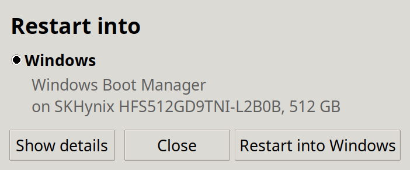

# Dual Boot Switcher

Restart a dual-boot PC straight into the other operating system with one
click: from Linux into Windows, or from Windows into Linux. No boot menu, no
pressing F12 at the right moment.



*Windows screenshot: coming soon.*

**Download:** [Windows (DualBootSwitcher.exe)](https://github.com/sharkbeans/dualboot/releases/latest/download/DualBootSwitcher.exe)
· [Linux (dualboot-switcher.deb)](https://github.com/sharkbeans/dualboot/releases/latest/download/dualboot-switcher.deb)

**Nothing to set up.** You don't need Git, Python or any developer tools: download
one file and run it.

Works on PCs that boot in **UEFI mode** (almost every PC from the last ten
years) with Windows 10/11 and a Debian-based Linux such as Ubuntu, Linux Mint,
LMDE or Debian.

## Install

### Windows

1. Download [DualBootSwitcher.exe](https://github.com/sharkbeans/dualboot/releases/latest/download/DualBootSwitcher.exe).
2. Double-click it. Windows asks for administrator permission (the app needs
   it to read and set the boot entry). Click **Yes**.

It's a single file with everything included; there's nothing to install. Put
it wherever you like, for example on the desktop.

**"Windows protected your PC"?** The .exe isn't code-signed (signing
certificates cost money every year), so Windows SmartScreen warns about it.
Click **More info**, then **Run anyway**. The source code is all in this
repository, the release files are built from it by GitHub Actions (see
[the workflow](.github/workflows/release.yml)), and the app shows the exact
commands it runs under **Show details** before it does anything. Some antivirus
programs also flag apps built with PyInstaller by mistake; each release's
notes list the SHA-256 checksums of its files.

### Linux (Debian, Ubuntu, Linux Mint, LMDE)

1. Download [dualboot-switcher.deb](https://github.com/sharkbeans/dualboot/releases/latest/download/dualboot-switcher.deb).
2. Double-click it to open it in your package installer, or run this in the
   folder you downloaded it to:

   ```bash
   sudo apt install ./dualboot-switcher.deb
   ```

   apt installs what it needs (Python 3, Tk, efibootmgr, pkexec) automatically.
3. Open **Dual Boot Switcher** from the applications menu.

To remove it: `sudo apt remove dualboot-switcher`.

## Use

1. Open the app. It shows what it will restart into, and on Linux which disk
   that's on.
2. If it found more than one possible system (say, two Linux installs), pick
   one. Your choice is remembered.
3. Click **Restart into ...** and confirm. Save your work first: open programs
   are closed.

On Linux you're asked for your password; it's remembered for a few minutes.

**Try it safely first:** start it with `--dry-run` and it goes through
everything except changing the boot entry and restarting.

- Linux: `dualboot-switcher --dry-run`
- Windows: press Win+R and run `"C:\path\to\DualBootSwitcher.exe" --dry-run`

On Linux there's also a command line: `dualboot-switcher list` shows every boot
entry and what the app would pick, and `dualboot-switcher switch --dry-run`
prints the exact commands.

## How it works

UEFI firmware keeps a list of boot entries, one per installed system, each
pointing at a boot loader file on a disk. It also supports a **one-time
override**: "for the next boot only, start this entry". The app sets that
override and restarts:

| Running on | What it runs |
|---|---|
| Linux | `efibootmgr --bootnext <entry>`, then `systemctl reboot` |
| Windows | `bcdedit /set {fwbootmgr} bootsequence {<entry>}`, then `shutdown /r /t 0` |

The override applies to the next boot only. **Your normal boot order is never
changed**, so the restart after that goes wherever it normally would.

**How it finds the other system.** It reads the boot entries (`efibootmgr -v`
on Linux, `bcdedit /enum firmware` on Windows) and decides by the boot loader
file each one points at, not by its name:

- Windows: `\EFI\Microsoft\Boot\bootmgfw.efi`
- Linux: `\EFI\<name>\shimx64.efi`, `grubx64.efi` or `systemd-bootx64.efi`,
  or a folder named after a known distribution. Names alone aren't reliable:
  LMDE, for example, registers itself as "debian".
- Never offered: firmware tools (Setup, Boot Menu, Diagnostics, Recovery,
  secure wipe tools), USB, CD, network (PXE) and generic disk entries, and the
  removable-media fallback `\EFI\BOOT\BOOTX64.EFI`.

If exactly one entry matches, it's used. If several do, you choose, and the
choice is saved in `~/.config/dualboot-switcher/config.json` on Linux or
`%APPDATA%\dualboot-switcher\config.json` on Windows. Delete that file to be
asked again.

## Safety

- **Open source, commands visible.** Click **Show details** to see the exact
  command before you restart, and the boot entries the app found (tick **Show
  other entries** to include Windows' own internal ones, like `{bootmgr}`).
- **One-time only.** It only ever sets the one-time override, never the
  permanent boot order.
- **It asks first.** Restarting always needs a confirmation, which warns
  about unsaved work.
- **Linux: minimal root access.** The app runs as you. The one step that
  needs root runs through polkit (you enter your password) and a small helper
  script, `/usr/libexec/dualboot-switcher/dualboot-switcher-helper`. The
  helper is owned by root and can't be edited by users. It re-checks its
  input and only accepts entries that boot a file from a disk, so it can't be
  used to start firmware tools or boot from USB or the network. It's about 40
  lines; [read it](packaging/linux/dualboot-switcher-helper).
- **Windows:** `bcdedit.exe` and `shutdown.exe` are called by their full path
  in `C:\Windows\System32`, so a stray program with the same name in your
  Downloads folder can't be run in their place.

### No password prompt (optional, Linux)

By default, switching asks for your password. To skip it for members of the
`sudo` group in a local session, create
`/etc/polkit-1/rules.d/50-dualboot-switcher.rules` (polkit 0.106 or newer,
which Debian 12+, Ubuntu 23.10+ and LMDE 6+ have):

```js
polkit.addRule(function (action, subject) {
    if (action.id == "io.github.sharkbeans.dualboot.switch" &&
        subject.local && subject.active && subject.isInGroup("sudo")) {
        return polkit.Result.YES;
    }
});
```

Anyone in that group, sitting at the computer, can then restart into the other
system without a password. That's the same as the restart button in your
desktop's menu, but it's your call.

## Didn't work?

**It restarted, but back into the same system (or into the boot menu).** Some
firmware ignores or clears the one-time override (`BootNext` /
`bootsequence`), and there's nothing an app can do about that. Things to try:
update your PC's firmware (BIOS/UEFI), and turn off "Fast Boot" in the
firmware settings. Also check under **Show details** (or with
`dualboot-switcher list` on Linux) that the app picked the entry you expect.

**"This machine booted in legacy BIOS mode".** The app only works with UEFI.
If your systems were installed in legacy (BIOS/CSM) mode, there are no UEFI
boot entries to switch between. Converting an installation to UEFI is possible
(Windows has `mbr2gpt`) but it's a bigger job; look it up for your system
before trying.

**"No Windows Boot Manager entry was found" / "No Linux entry was found".**
The other system's boot entry is missing. That happens when it was installed
in legacy mode, or when a firmware reset or update deleted the entry. To
recreate it:

- Windows entry: from an Administrator Command Prompt in Windows, run
  `bcdboot C:\Windows`.
- Linux entry (Debian/Ubuntu/Mint): in Linux, run
  `sudo grub-install && sudo update-grub`.

**Linux won't start, with a Secure Boot or "verification failed" error.**
With Secure Boot on, the firmware only starts signed boot loaders. Linux
distributions handle that through `shimx64.efi`. If the Linux entry points
straight at `grubx64.efi` instead, the firmware may refuse it. Look at the
entry under **Show details**; reinstalling your distribution's signed boot
loader packages (`shim-signed`, `grub-efi-amd64-signed`) and running
`sudo grub-install` usually restores the shim entry.

**Windows asks for a BitLocker recovery key.** Changes to how a PC boots can
make BitLocker ask for the recovery key. Keep it at hand before you first try
a new boot setup (it's in your Microsoft account if you signed in with one).

**"needs administrator rights" (Windows).** Run the .exe normally and click
**Yes** on the permission prompt; don't use "Run as a different user".

**Something else**, or it picked the wrong entry: open the app, click **Show
details**, then **Copy boot entries**, and paste that into a
[new issue](https://github.com/sharkbeans/dualboot/issues). Replace anything
that looks like `{xxxxxxxx-xxxx-...}` with zeros if you'd rather not share it.

## For developers

The app is plain Python 3.10+ with Tkinter and no other dependencies.

```bash
python3 -m unittest                          # run the tests
python3 -m dualboot_switcher --dry-run       # open the window from the source tree
python3 -m dualboot_switcher list            # command line
./packaging/linux/build-deb.sh               # build dist/dualboot-switcher.deb
```

The Windows .exe is built by GitHub Actions with PyInstaller
([packaging/windows/build-exe.ps1](packaging/windows/build-exe.ps1)). Pushing
a `v*` tag builds both packages and publishes a release; tags with a `-` (like
`v0.2.0-rc1`) become pre-releases. Running the **Release** workflow by hand
builds both and attaches them to the run without releasing anything.

Layout:

| Path | What |
|---|---|
| `dualboot_switcher/parse_*.py` | Parse `efibootmgr -v` and `bcdedit /enum firmware` output |
| `dualboot_switcher/classify.py` | Decide which entry belongs to which OS; pick the target |
| `dualboot_switcher/backend_*.py` | Run the OS commands |
| `dualboot_switcher/cli.py`, `gui.py` | Command line and window |
| `packaging/` | .deb contents and build script, PyInstaller build |
| `tests/fixtures/` | Real command output used by the tests |

### Contributing

Bug reports and pull requests are welcome. Keep changes small and the code
plain; this is maintained by one person. The most useful contribution is
output from your machine that the app gets wrong: add it to `tests/fixtures/`
(with GUIDs replaced by zeros, see [tests/fixtures/README.md](tests/fixtures/README.md)),
add a test, and make `python3 -m unittest` pass.

## License

[MIT](LICENSE)
